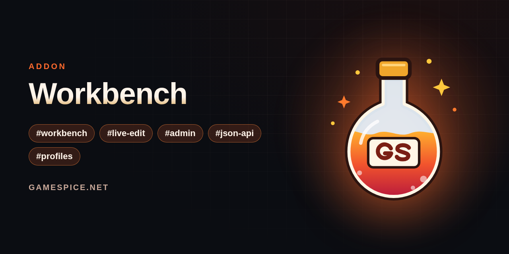
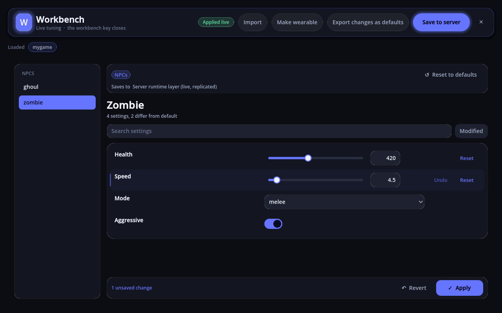
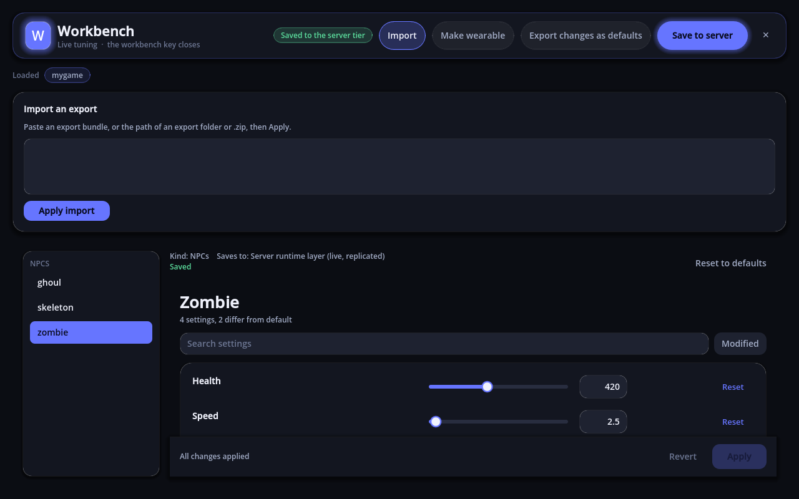
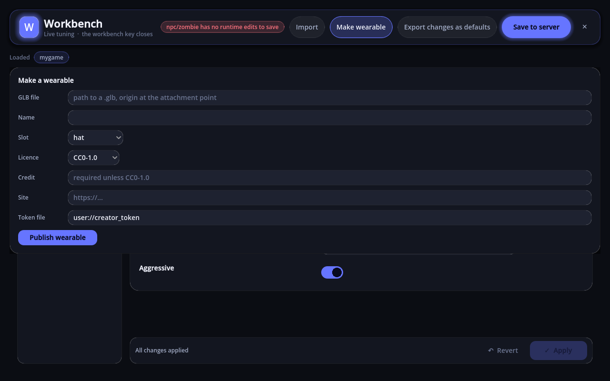
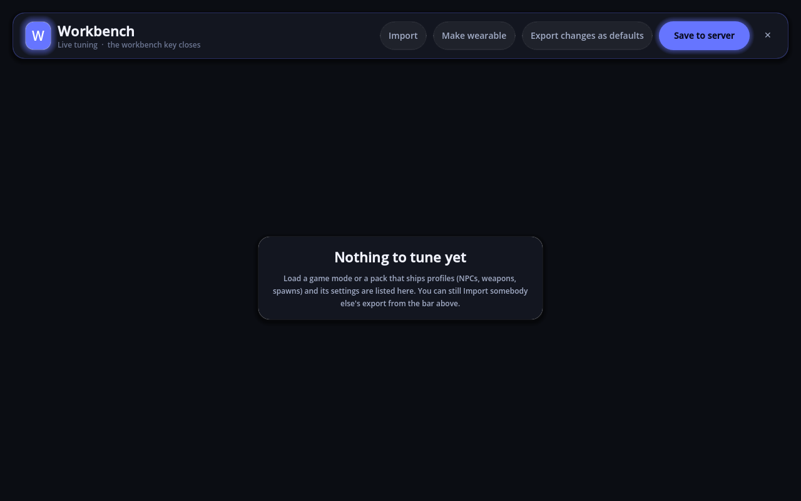
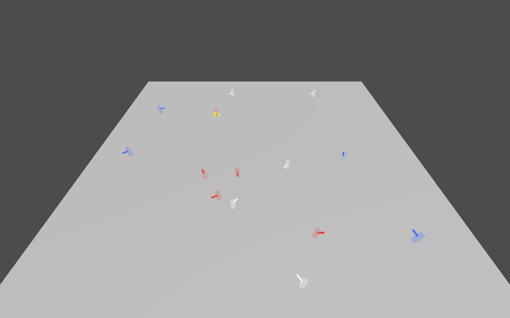
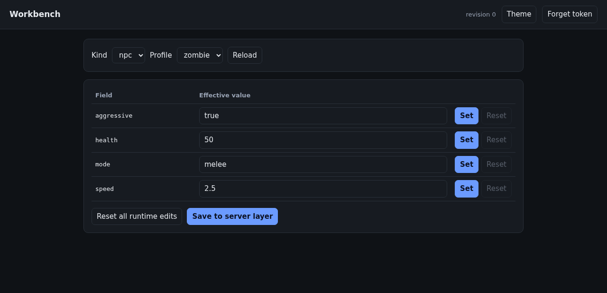
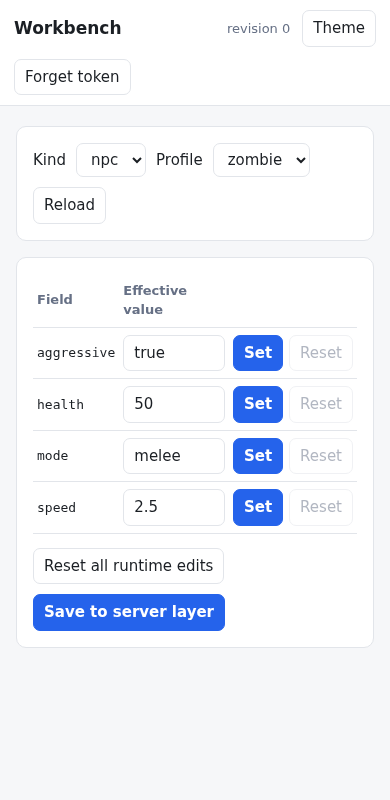

[](https://moddingcommunity.com/a/109-gs-workbench)

Live-edit profiles on a running game. A JSON API over `DotProfileRuntime`, an in-game window, and an off-by-default loopback web page. Tune values while playing, then export only what you changed.

## What it looks like

The in-game window: pick a profile on the left, drag a value, and the change is live at once. Rows you changed are marked, **Apply** and **Revert** wait at the bottom, and **Save to server** writes the open profile.



**Import** takes an export bundle, an export folder or a zip from somebody else's tuning session. It goes through the same checks as any edit, and the button stays lit while the drawer is open.



**Make wearable** publishes a GLB as a wearable with a creator token. The site validates and moderates; the form only pre-checks the fields.



With nothing loaded the window says so and points at Import, instead of showing a blank editor.



Spawn authoring is point and click in the game's own view: click to add or select a point, Q/E turn it, T sets the team, F places a flag stand.



The off-by-default web page edits the same profiles from a browser, on desktop and on a phone:




The screenshots are rendered on a real GPU by `tools/menu_shot.gd`, `tools/panel_shot.gd` and `tools/spawn_shot.gd` and are refreshed whenever the look changes.

## Install

1. Get [Godot 4.7](https://godotengine.org/download).
2. Either use [dot-bootstrap](https://github.com/gamespice-platform/bootstrap), which clones every project and links the addons, or copy `addons/dot_workbench/` and [dot-core](https://github.com/gamespice-platform/core)'s `addons/dot_core/` into your project and enable dot-workbench in *Project > Project Settings > Plugins*.

## Web page and API

Enable it in `cfg/server.yml`. The token lives in a file, never in the yml, environment or command line.

```yaml
workbench:
  enabled: true
  bind: 127.0.0.1
  port: 8790
  token_file: /etc/dot/workbench.token
```

The host creates `DotWorkbenchHttp.new(api)`, calls `start_from_config(DotWorkbenchHttp.read_config())` and calls `poll()` from `_process`. All routes except the page need `Authorization: Bearer <token>`.

| Route | Does |
| --- | --- |
| `GET /` | The page. |
| `POST /api` | The JSON envelope. |
| `GET /api/profiles[/kind[/id]]` | Read profiles. |
| `PUT /api/profiles/kind/id/key` with `{"value": ...}` | Change a value. |
| `DELETE /api/profiles/kind/id[/key]` | Reset a value or profile. |
| `POST /api/profiles/save/kind/id` | Save. |

An exported host needs `*.html` in the preset's `include_filter`, or the page is missing from the pack ([design](docs/design.md#hosting-it-in-a-game-and-exporting-it)).

## In-game window

The workbench is a window on the `;` key, rebindable as `bind_workbench` in the controls settings, or the console command `workbench`. It is on in the editor, in debug builds and for whoever hosts a listen game, and off in a production build. Pick a profile, change values, press Apply. The change is live at once, and nothing is saved until you ask.

When the game feels right, press **Export changes as defaults**. It writes only the values that differ from the shipped defaults, one small yml per profile in the repository's `cfg/` layout, to `user://workbench-export/<date_time>/`, as a zip beside that folder, and as text on your clipboard. To adopt it, copy the `cfg/` folder over the repository's `cfg/` and commit; `game-cvars.yml`, when present, goes into the `cvars:` block of `game.yml`.

To try somebody else's tuning, press **Import** and paste the text, or give the path of an export folder or zip, then Apply. It goes through the same checks as any edit: out-of-range values and unknown profiles are skipped and listed.

| Class | Role |
| --- | --- |
| `DotWorkbenchExport` | Behind both buttons: `collect()`, `export_changes()`, `import_source(actor, source)`. |
| `DotWorkbenchOverlay` | The window. |
| `DotWorkbenchScope` | Tags a set with owner, side, `requires` and `listed`, so the window only lists what is loaded. |
| `DotWorkbenchSetView` | One heading per member of a grouped set, such as one per weapon pack. |

A game hosts the window with dot-game's `DotGameWorkbench` (see dot-game's `docs/workbench.md`).

## Identity

`DotWorkbenchIdentity` is an admin-only gate for `api.identity`, a thin subclass of dot-core's `DotAdminIdentity`. Nothing is imported: the host gives it a `resolver` Callable(token) returning a `DotAuthIdentity` or a Dictionary with `uid`, and optionally a `fallback_permit` Callable(uid, flag) backed by an admin manager. Access is denied by default: only `admin_uids` and members of `admin_groups` get in. Actors are logged as `id:<uid>`, and tokens are never logged. `gate.attach(api)` installs it, and the admin token keeps working beside it.

## Testing

Import the project once, then run `examples/workbench_selftest.tscn` headless with Godot. Design notes: [docs/design.md](docs/design.md).

## Quality and ongoing improvement

The models, textures, animations, sounds and maps of the packs this tool tunes, and the window itself, are improved automatically and recursively by AI agents. [Nightly](https://github.com/gamemann/nightly) keeps a board of improvement items. Agents pick up an item, make the change, render fresh frames and check them with a visual judge. Judge findings become new items, and the loop repeats until the result is production quality. Improvements ship as new pack versions, and the screenshots in this README are re-shot each time. Anything rough you meet is worth an [issue](https://github.com/gamespice-platform/workbench/issues).

## Status and licence

Part of the [**GameSpice**](https://gamespice.net) platform: a family of Godot addons. Written with Claude Code and maintained by `gamemann`. Every addon has headless tests, but little of this has been played by real users yet, so expect rough edges and please [open an issue](https://github.com/gamespice-platform/workbench/issues) when you hit one.

MIT licence, see [LICENSE](LICENSE). The only closed part of the [**GameSpice**](https://gamespice.net) platform is the web back end; you can use your own instead of GameSpice's.
